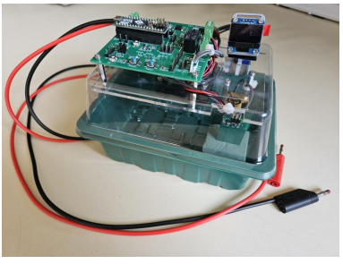
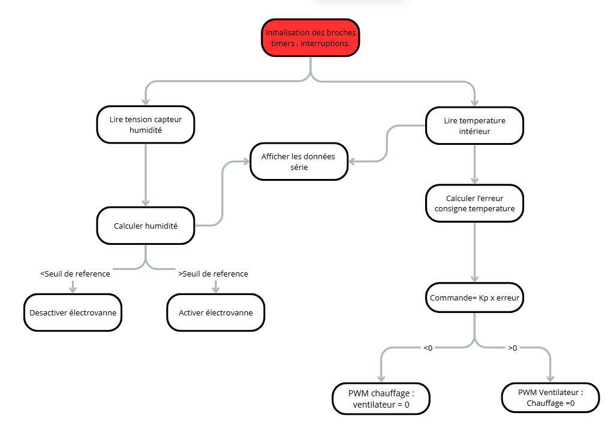
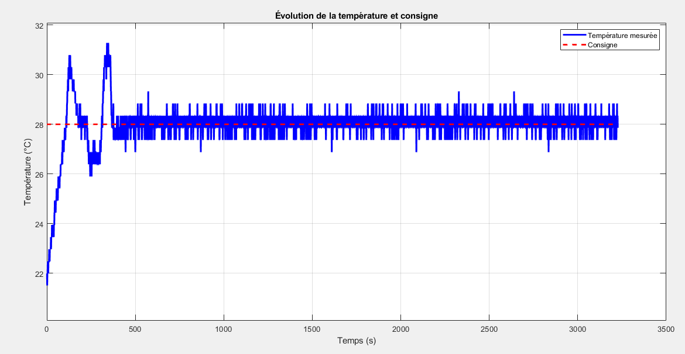
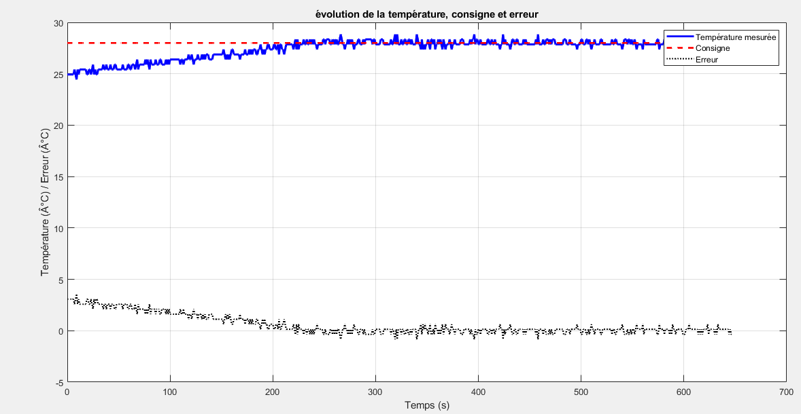
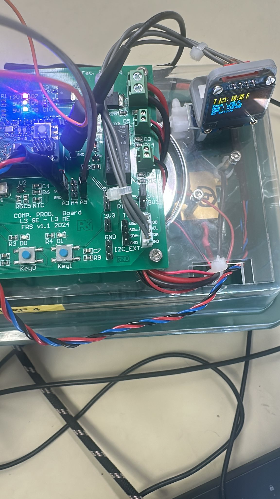
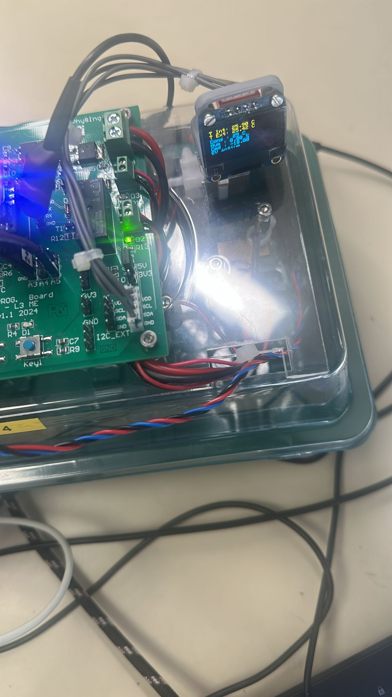

# 🌱 Automated Greenhouse Monitoring & Control System

### Embedded Systems | Arduino Micro | Temperature Regulation | Sensor Integration

**Project Type:** University Embedded Systems Project  
**Institution:** University of Strasbourg — Faculty of Physics and Engineering  
**Program:** Mechatronics and Electronic Systems  
**Contributors:** Leroy Makita Loubaki & Martin Roger

---

## 📖 1. Project Overview

This project focuses on the development of an **automated greenhouse monitoring and control system** using an Arduino Micro microcontroller.

The objective is to implement an embedded system capable of monitoring environmental parameters and controlling actuators to regulate greenhouse conditions.

The project combines:

- Embedded C/C++ programming
- Analog sensor acquisition
- Hardware timers and interrupts
- Temperature regulation
- Humidity-based actuator control
- OLED display integration

A laboratory-scale prototype was used to develop and test the system.

## 🎯 2. Project Objectives

- Acquire internal and external temperature measurements.
- Measure humidity using a capacitive sensor.
- Implement periodic acquisition using hardware timers.
- Regulate temperature with heating and ventilation.
- Activate an electrovalve according to humidity measurements.
- Adjust the temperature setpoint using a push button.
- Display measurements and system status on an OLED screen.
- Compare different temperature control strategies.

## 🛠️ 3. Hardware Components

| Component | Function |
|---|---|
| Arduino Micro — ATmega32U4 | Main embedded controller |
| LM35 Temperature Sensors | Internal and external temperature acquisition |
| Capacitive Humidity Sensor | Humidity measurement |
| 12V Fan | Cooling |
| Heating Resistor | Heating |
| 12V Solenoid Valve | Humidity regulation |
| OLED SSD1306 | Data and status visualization |
| Push Button | Temperature setpoint adjustment |

## ⚙️ 4. Embedded System Architecture

The Arduino Micro processes sensor signals and controls the greenhouse actuators.

**Temperature Sensors + Humidity Sensor → Arduino Micro → Control Algorithms → Fan / Heater / Solenoid Valve**

The OLED display provides information about measured temperatures, humidity and actuator status.

## ⏱️ 5. Hardware Timers and Interrupts

The project explores hardware timer configuration on the ATmega32U4.

### Periodic Acquisition

A one-second time base was developed using Timer3 to support periodic operations.

### Humidity Sensor Excitation

Timer1 was configured to generate a 1 MHz square-wave signal required for the capacitive humidity sensor.

These functions demonstrate low-level embedded programming using hardware registers and interrupts.

## 🌡️ 6. Temperature Measurement

Two LM35 analog temperature sensors were used to measure the greenhouse's internal and external temperatures.

The LM35 provides an output voltage proportional to temperature:

**10 mV/°C**

Temperature acquisition was implemented using a dedicated C++ class to improve code modularity and reuse.

## 💧 7. Humidity Measurement

The humidity acquisition system uses a capacitive sensor excited by a 1 MHz signal.

Two approaches were investigated:

1. Empirical linear mapping of analog measurements.
2. A logarithmic model derived from experimental calibration data.

The second approach provides a better representation of the sensor response over part of its operating range.

However, the experimental results also reveal increasing measurement errors in the high-humidity range.

## 🔥 8. Temperature Regulation

Three control strategies were investigated.

### On/Off Control

The initial approach activates heating or ventilation depending on whether the measured temperature is below or above the desired setpoint.

This method is simple but can produce significant oscillations.

### Time-Proportional Control

A second approach adjusts actuator activation duration according to temperature error.

Its main limitation is the use of blocking delays.

### Proportional PWM Control

The final approach applies proportional control through PWM commands to the heating or cooling actuator.

### Experimental Comparison

| Metric | On/Off Control | Proportional PWM |
|---|---:|---:|
| Rise Time | 65 s | 220 s |
| Maximum Overshoot | 53.8% | 14.3% |
| Reported Response / Stabilization Time | Approximately 500 s | Approximately 300 s |

These values are taken from the experimental report. The tests used different initial conditions, so they should be interpreted as an illustrative comparison rather than a strictly controlled benchmark.

## 🚰 9. Humidity-Based Solenoid Valve Control

The solenoid valve is controlled using a fixed humidity threshold:

- Humidity below 20%: activate the valve.
- Humidity at or above 20%: deactivate the valve.

During testing, relay switching and LED indication were used to verify the control logic. Actual water irrigation was not demonstrated.

## 🖥️ 10. OLED Display

An SSD1306 OLED display was integrated through the I²C interface.

The display provides:

- Internal temperature
- Target temperature
- Humidity level
- Temperature control status
- Solenoid valve status

## 📊 11. Experimental Results

The project report documents:

- Temperature sensor measurements
- Humidity sensor calibration
## 📸 Project Gallery

### Greenhouse Prototype

### System Control Flowchart

### Temperature Regulation — On/Off Control

### Temperature Regulation — Proportional PWM Control

### Humidity Control Demonstration

**Humidity Above Threshold**

**Humidity Below Threshold**

*The actuator control was verified electrically. Actual water irrigation was not demonstrated.*
